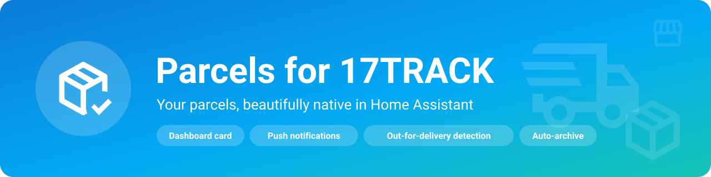
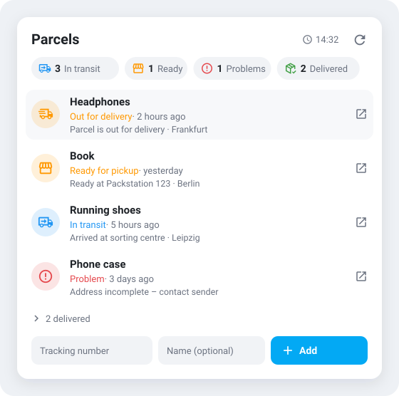
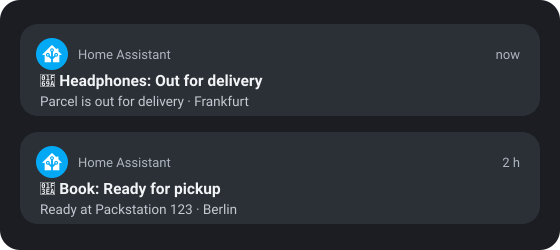
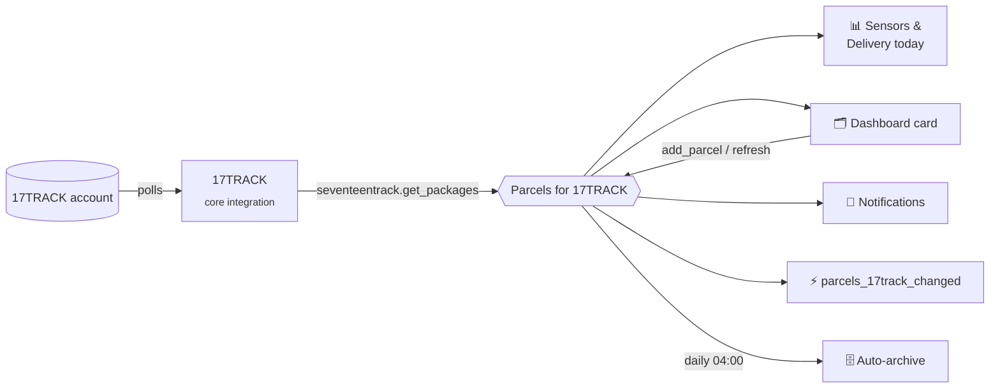

<p align="center">
  
</p>

<p align="center">
  <a href="https://github.com/benkl/ha-parcels-17track/releases"></a>
  <a href="https://hacs.xyz"></a>
  
  <a href="https://github.com/benkl/ha-parcels-17track/actions/workflows/validate.yml"></a>
  <a href="LICENSE"></a>
</p>

<p align="center">
  <b>See every parcel at a glance, know when it's out for delivery, and get notified the moment it's ready.</b><br>
  Built on Home Assistant's official <a href="https://www.home-assistant.io/integrations/seventeentrack/">17TRACK integration</a>, with a dashboard card, notifications and services added on top.
</p>

<p align="center">
  <a href="https://my.home-assistant.io/redirect/hacs_repository/?owner=benkl&repository=ha-parcels-17track&category=integration"></a>
  &nbsp;
  <a href="https://my.home-assistant.io/redirect/config_flow_start/?domain=parcels_17track"></a>
</p>

---

<table>
<tr>
<td width="52%" valign="top">

<picture>
  <source media="(prefers-color-scheme: dark)" srcset="docs/images/card-dark.svg">
  
</picture>

</td>
<td width="48%" valign="top">

### ✨ Highlights

- 🗂️ **A card that looks built-in**: status bubbles, latest event, location and "2 hours ago". Parcels that need attention come first.
- 🚚 **"Out for delivery" detection**, which 17TRACK itself doesn't report.
- 🔔 **Push notifications** for new, on its way, out for delivery, ready for pickup, delivered and problem. Tapping one opens the parcel.
- ➕ **Add parcels from the card**, also for non-admin users.
- 🗄️ **Auto-archive** of delivered parcels after *n* days.
- 🧩 **Sensors, a binary sensor, services and events** for your own automations.
- 💾 **Remembers parcel states across restarts**, so you never get duplicate notifications or miss a change.
- 🌍 English & Deutsch



</td>
</tr>
</table>

## 📑 Contents

- [How it works](#how-it-works)
- [Installation](#installation)
- [Configuration](#configuration)
- [Dashboard card](#dashboard-card)
- [Entities](#entities)
- [Services](#services)
- [Events & automation examples](#events)
- [FAQ & troubleshooting](#faq)
- [Development](#development)

<a id="how-it-works"></a>

## 🧭 How it works



Parcels for 17TRACK doesn't log in to 17TRACK itself. It uses the account you've already connected through the built-in **17TRACK** integration and:

1. polls it on your interval (default 30 min),
2. normalises and sorts the parcels (problems → out for delivery → ready → in transit → delivered),
3. compares the result with the last known state (stored on disk) and sends notifications and events for real changes only.

<a id="installation"></a>

## 📦 Installation

> [!IMPORTANT]
> Set up the built-in **17TRACK** integration first (Settings → Devices & services → Add integration → *17TRACK*).

### Via HACS (recommended)

1. Click **Open in HACS** above, or go to HACS → ⋮ → **Custom repositories** and add `https://github.com/benkl/ha-parcels-17track` as type **Integration**.
2. Install **Parcels for 17TRACK** and **restart Home Assistant**.
3. Click **Add integration** above, or go to Settings → Devices & services → Add integration → *Parcels for 17TRACK*.
4. Pick your 17TRACK account. That's it 🎉

### Manual

<details>
<summary>Copy the files yourself</summary>

1. Download the [latest release](https://github.com/benkl/ha-parcels-17track/releases/latest).
2. Copy `custom_components/parcels_17track` into your `config/custom_components/` folder.
3. Restart Home Assistant and add the integration as above.

</details>

<a id="configuration"></a>

## ⚙️ Configuration

Everything is set in the UI: **Settings → Devices & services → Parcels for 17TRACK → Configure**.

| Option | Default | What it does |
|---|---|---|
| **Refresh interval** | `30 min` | How often 17TRACK is asked for updates (5–360 min). |
| **Send notifications to** | – | One or more notify services, e.g. `notify.mobile_app_pixel_9`. Leave it empty to only fire events. |
| **Notify about** | all | `New parcel`, `On its way`, `Out for delivery`, `Ready for pickup`, `Delivered`, `Problem`. |
| **Archive delivered parcels after** | `3 days` | Archives parcels in your 17TRACK account, daily at 04:00. `0` turns it off. |
| **"Out for delivery" keywords** | EN · DE · FR · IT · ES · NL | Comma separated. If the latest tracking event contains one of them, the parcel is shown as *out for delivery*. |

> [!TIP]
> Notifications to the **companion app** (`notify.mobile_app_*`) are grouped. Each parcel updates its own notification instead of stacking new ones, and tapping it opens the parcel on 17TRACK.

<a id="dashboard-card"></a>

## 🗂️ Dashboard card

The card is registered automatically, so you don't need to add a resource. Pick **17TRACK Parcels** in the card picker, which comes with a visual editor, or use YAML:

```yaml
type: custom:parcels-17track-card
entity: sensor.17track_parcels_open_parcels
title: Parcels          # optional
show_delivered: true    # optional – collapsible list of delivered parcels
show_add_form: true     # optional – tracking number + name + "Add"
```

| Option | Type | Default | Description |
|---|---|---|---|
| `entity` | entity | **required** | The *Open parcels* sensor of this integration. |
| `title` | string | – | Card title. |
| `show_delivered` | boolean | `true` | Show delivered parcels, folded away. |
| `show_add_form` | boolean | `true` | Show the add-parcel form. |

Tap a parcel to open it on 17TRACK, or use ⟳ to refresh right away. The card follows your theme and language and works in light and dark mode.

<a id="entities"></a>

## 📊 Entities

All entities belong to one **17TRACK Parcels** device per account.

| Entity | Example ID | State | Notes |
|---|---|---|---|
| Open parcels | `sensor.17track_parcels_open_parcels` | `4` | All parcels in the `parcels` attribute (not stored in history), plus counts and `last_success`. |
| In transit | `sensor.17track_parcels_in_transit` | `3` | Includes *out for delivery* and *no data yet*. |
| Out for delivery | `sensor.17track_parcels_out_for_delivery` | `1` | |
| Ready for pickup | `sensor.17track_parcels_ready_for_pickup` | `1` | |
| Delivered | `sensor.17track_parcels_delivered` | `2` | Not yet archived. |
| Problems | `sensor.17track_parcels_problems` | `0` | Alert, delivery failed, expired. |
| Last update | `sensor.17track_parcels_last_update` | timestamp | Diagnostic. |
| Delivery today | `binary_sensor.17track_parcels_delivery_today` | `on` | `parcels` attribute lists the names. |

<details>
<summary>Shape of a parcel in the <code>parcels</code> attribute</summary>

```yaml
tracking_number: JJD000390012345678
name: Headphones            # friendly name, falls back to the tracking number
state: out_for_delivery     # alert | undelivered | expired | out_for_delivery |
                            # ready_to_be_picked_up | in_transit | not_found | delivered
status: In Transit          # raw 17TRACK status
info_text: Parcel is out for delivery
location: Frankfurt
timestamp: "2026-11-19T08:10:00+00:00"
origin_country: Germany
destination_country: Germany
url: https://t.17track.net/en#nums=JJD000390012345678
```

</details>

<a id="services"></a>

## 🛠️ Services

| Service | Fields | Description |
|---|---|---|
| `parcels_17track.add_parcel` | `tracking_number`, `name`*?*, `config_entry_id`*?* | Adds a parcel to your 17TRACK account. The list refreshes ~15 s later. |
| `parcels_17track.archive_parcel` | `tracking_number`, `config_entry_id`*?* | Archives a parcel. |
| `parcels_17track.refresh` | `config_entry_id`*?* | Polls 17TRACK right now. |

`config_entry_id` is only needed if you've linked more than one 17TRACK account.

```yaml
action: parcels_17track.add_parcel
data:
  tracking_number: JJD000390012345678
  name: Headphones
```

<a id="events"></a>

## ⚡ Events & automation examples

Every change fires **`parcels_17track_changed`**, even for changes you don't get notified about:

| Field | Example |
|---|---|
| `type` | `new` · `in_transit` · `out_for_delivery` · `ready_for_pickup` · `delivered` · `problem` |
| `state` / `previous_state` | `out_for_delivery` / `in_transit` |
| `tracking_number`, `name`, `info_text`, `location`, `url` | |

<details>
<summary>🔊 Announce pickups on a speaker</summary>

```yaml
alias: Parcel ready for pickup
triggers:
  - trigger: event
    event_type: parcels_17track_changed
    event_data:
      type: ready_for_pickup
actions:
  - action: tts.speak
    target:
      entity_id: tts.home_assistant_cloud
    data:
      media_player_entity_id: media_player.kitchen
      message: "{{ trigger.event.data.name }} is ready for pickup."
```

</details>

<details>
<summary>💡 Flash the hallway light while a parcel is out for delivery</summary>

```yaml
alias: Parcel coming today
triggers:
  - trigger: state
    entity_id: binary_sensor.17track_parcels_delivery_today
    to: "on"
actions:
  - action: light.turn_on
    target:
      entity_id: light.hallway
    data:
      flash: long
      color_name: orange
```

</details>

<details>
<summary>📝 Add parcels from a shared shopping list or voice</summary>

```yaml
alias: Track parcel from todo list
triggers:
  - trigger: event
    event_type: call_service
    event_data:
      domain: todo
      service: add_item
conditions:
  - condition: template
    value_template: "{{ trigger.event.data.service_data.item is match('^track ', ignorecase=True) }}"
actions:
  - action: parcels_17track.add_parcel
    data:
      tracking_number: "{{ trigger.event.data.service_data.item.split(' ', 1)[1] }}"
```

</details>

<a id="faq"></a>

## ❓ FAQ & troubleshooting

<details>
<summary><b>The list is empty, but I have parcels</b></summary>

Parcels for 17TRACK shows exactly what the core integration returns. Check that the parcels show up in your 17TRACK account and aren't archived. To check the connection, run **`seventeentrack.get_packages`** in Developer tools → Actions.
</details>

<details>
<summary><b>A parcel isn't shown as "out for delivery"</b></summary>

17TRACK reports these parcels as *in transit*. Detection works through the keywords in the options, so add the wording your carrier uses (e.g. `wird zugestellt`).
</details>

<details>
<summary><b>I want notifications on several phones</b></summary>

Add several `notify.mobile_app_*` services under **Send notifications to**.
</details>

<details>
<summary><b>Non-admin users get "Unauthorized"</b></summary>

They shouldn't: all three services are regular (non-admin) services. If you call the core `seventeentrack.*` services directly from scripts, switch to `parcels_17track.*`.
</details>

<details>
<summary><b>Debug logging</b></summary>

```yaml
logger:
  logs:
    custom_components.parcels_17track: debug
```

Diagnostics (Settings → Devices & services → Parcels for 17TRACK → ⋮ → *Download diagnostics*) leave out tracking numbers, names and locations.
</details>

<a id="development"></a>

## 🧑‍💻 Development

```bash
pip install pytest
pytest -q tests                       # pure parcel logic: sorting, diffing, archive, texts
node --check custom_components/parcels_17track/frontend/parcels-17track-card.js
python docs/images/generate.py        # regenerate README images
```

CI runs **hassfest**, the **HACS validator** and the tests on every push. Issues and pull requests are welcome!

## 📜 License & credits

[MIT](LICENSE) © Benjamin Kleinert · Icons: [Material Design Icons](https://pictogrammers.com/library/mdi/) (Apache-2.0).

<sub>Not affiliated with or endorsed by 17TRACK. "17TRACK" is a trademark of its respective owner.</sub>
